# CoSkin

**Make Codex your own space.**

Animated backgrounds, matching icons and sidebar rows, and readable conversations. Preview a theme in Codex, then apply it to the app, a project, or a chat.

[한국어](README.md) · [English](README.en.md) · [日本語](README.ja.md) · [简体中文](README.zh-CN.md)

[Download for Windows](https://github.com/GNh0/CoSkin/releases/latest) · [Theme format](docs/theme-package-spec.md) · [Theme request template](docs/theme-request-template.md) · [Custom effects](docs/custom-effects.md) · [Compatibility](docs/support-matrix.md)

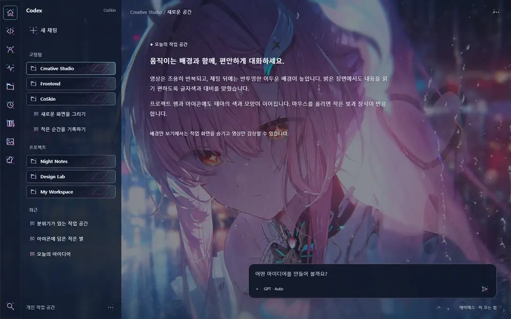

*Wuthering Waves Aemeath 2D video theme, rendered by CoSkin on a sample workspace layout. [Capture details](docs/media/current/README.md)*

## Get started

1. Download and extract the ZIP from the [latest release](https://github.com/GNh0/CoSkin/releases/latest).
2. Run **CoSkin.Loader.exe** and choose your installation options.
3. Start Codex and CoSkin, then open **CoSkin** in the left icon bar.
4. Import or create a theme, then choose **Preview → Apply**.

CoSkin can wait in the tray before Codex starts. Use the **CoSkin** desktop shortcut to run it independently, or **Codex + CoSkin** in the Start menu to launch both. No development tools are required.

Run both apps with the same Windows privilege level on **Windows x64**. CoSkin checks the original application's signature and connection capabilities. These features and captures use the **current main source based on CoSkin 0.1.18**; verified environments are listed in the [support matrix](docs/support-matrix.md).

## What can you customize?

| Feature | What it does |
| --- | --- |
| Backgrounds | PNG, JPEG, GIF, MP4 and WebM; muted loops, position, fit, opacity and video speed |
| Icons and rows | Images, colors, borders and decorations for navigation, project and chat rows |
| Readability | Automatic contrast or custom text color, font and weight; conversation background and video opacity |
| Effects | Hover, click, selection, enter, exit and repeating effects; static profiles |
| Scope | App, project or chat; all matching elements or one individual item |
| Library | Nested folders, tags, favorites, search, sorting, multiple selection, cards or a compact list |
| Sharing and downloads | Import, duplicate, export; original background extraction, conversion and download queue |
| Runtime | Window and playback limits, shared media storage, startup, shutdown and updates |

## One character, three moods

Each example has distinct icons and sidebar artwork. **Projects use outlined cards**, while **chats use quieter rows** with smaller icons and less decoration.

| Bubble Sky | Rainy Memories | Whispering Stars |
| :---: | :---: | :---: |
| 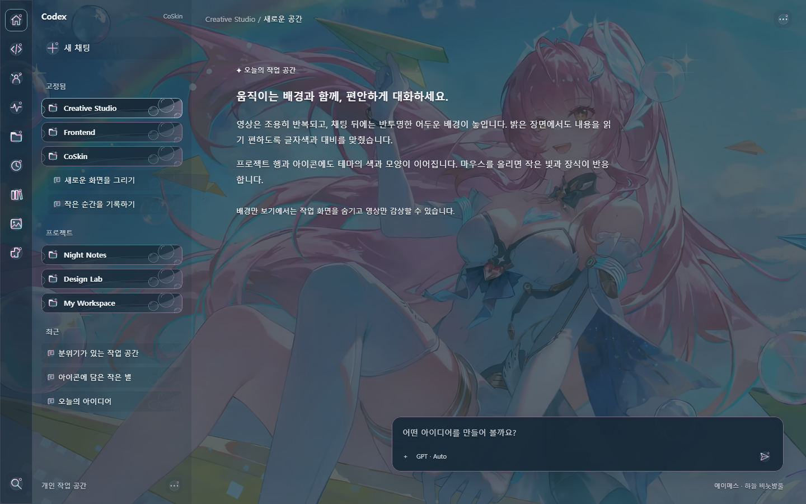 | 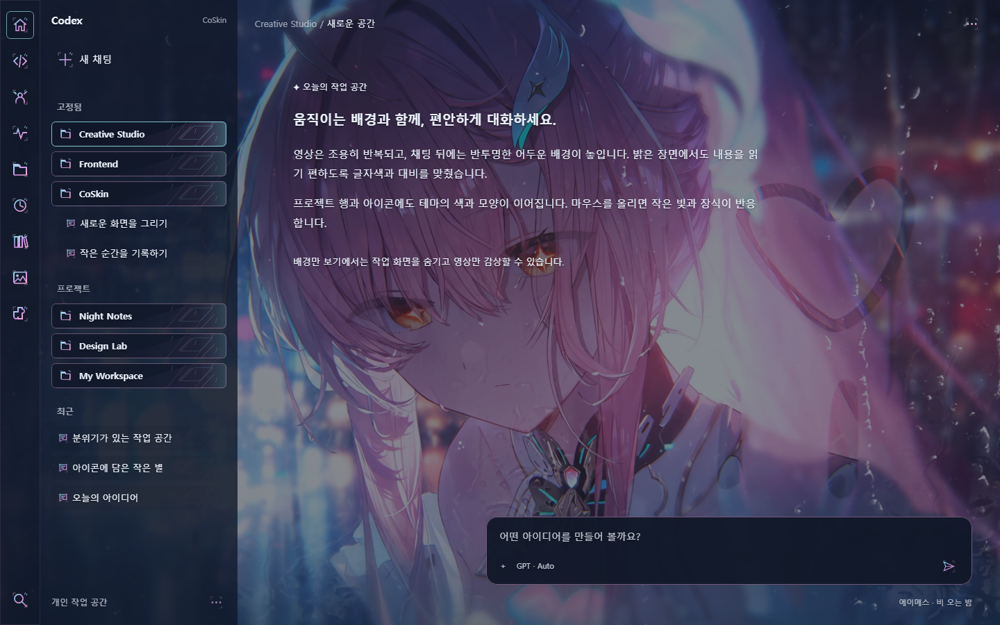 | 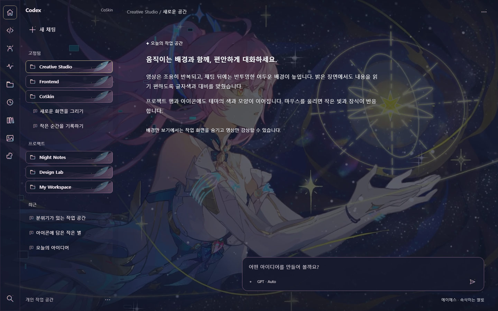 |
| Pearls, bubbles and aqua | Neon, rain and violet | Golden stars, wings and orbits |

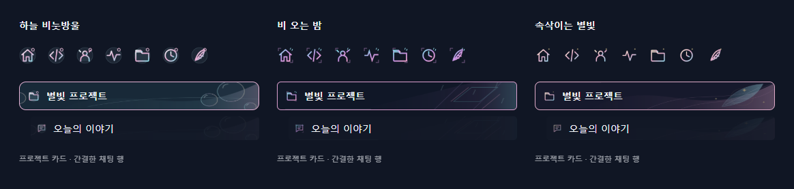

Watch the sky and starlight examples

**Bubble Sky**

**Whispering Stars**

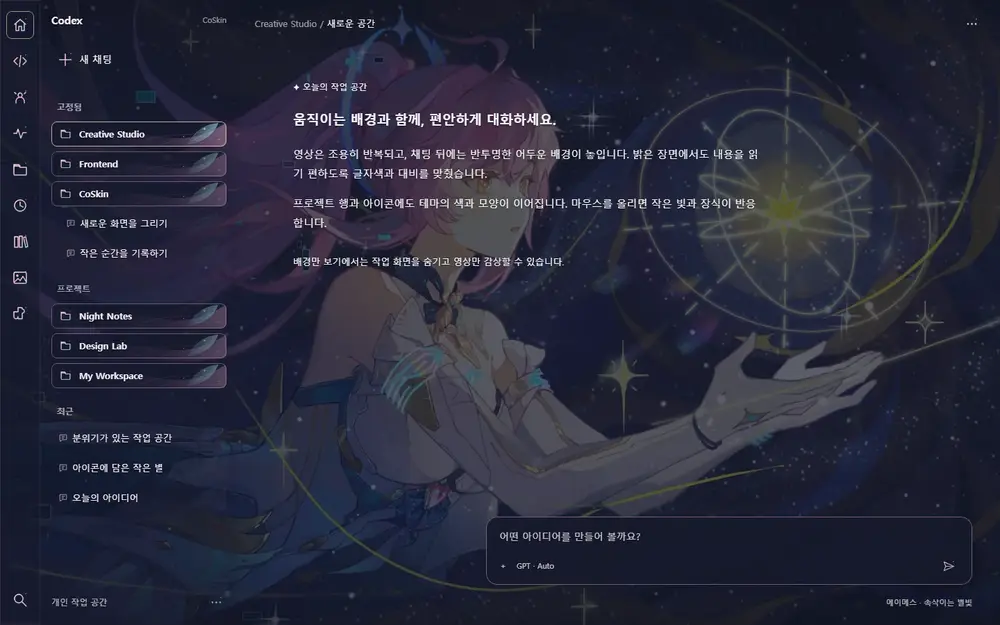

Each example includes an animated profile and a static **No effects** profile. These are unofficial fan themes, not a list of themes bundled with the installer. [Media credits](docs/media/current/ASSET-NOTES.md)

Additional 2D theme with character motion · Blue Resonance

**Blue Resonance** combines animated eyes, mouth, head, upper body and hair with aqua resonance icons and waveform row artwork.

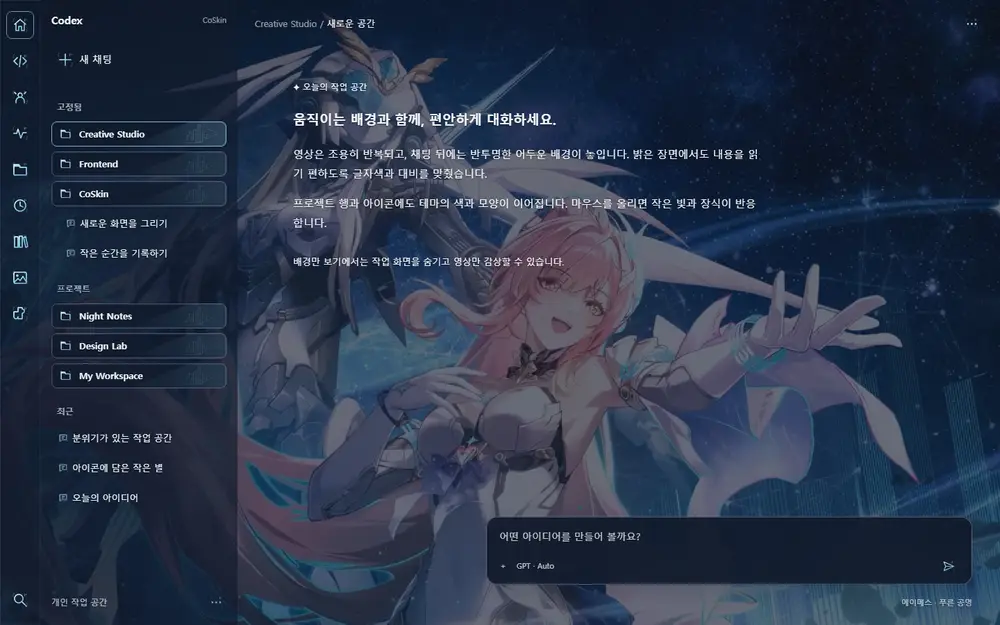

## Choose and organize themes

**Preview** shows a theme in the real Codex window. **Apply** commits it to your chosen scope; canceling restores the previous theme. Detail offers editing, metadata, duplication, export and background extraction.

| Library | Detail and preview |
| :---: | :---: |
| 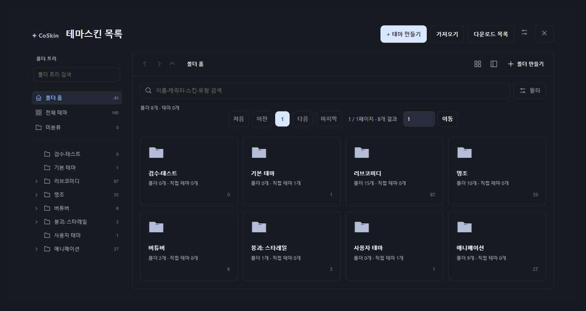 | 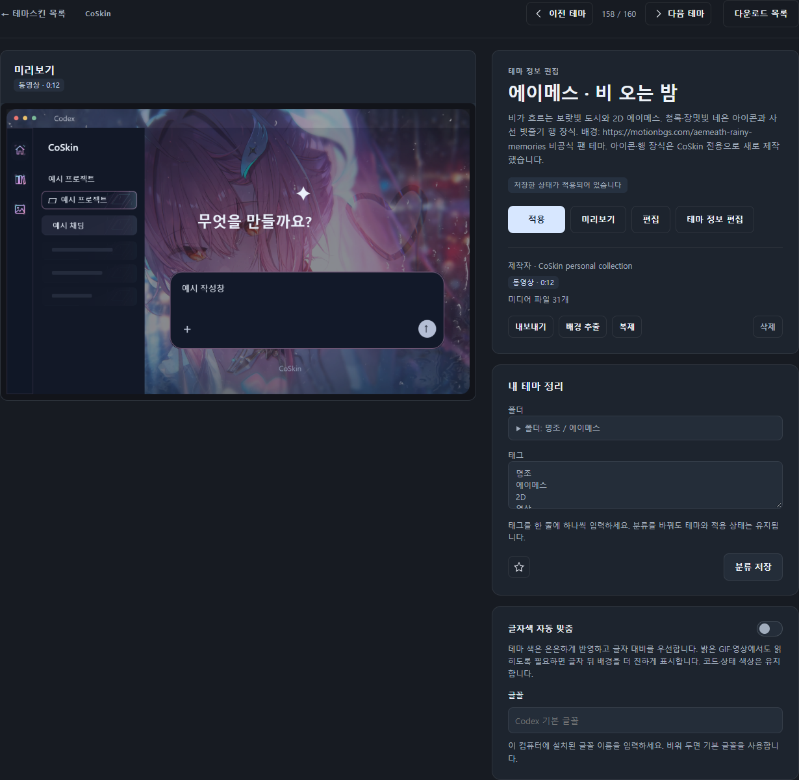 |

Open folders with a **double click or Enter**. Path, back, forward and up controls help navigation. Folder/tree navigation and preview-card/compact-row layouts can be switched independently; compact rows do not load media previews.

Search, tags, favorites, sorting, descendant folders and multiple selection organize large collections. Dragging changes classification without moving media. Choose **24/48/96 items per page** or jump to a page; returning from detail preserves your position. [Library guide](docs/theme-library.md)

## Edit the screen and keep text readable

Choose **Edit**, then **right-click** a region. Adjust backgrounds, the conversation area, composer, buttons, project or chat rows. Edit all matching elements or use **Individual** for one item.

For bright backgrounds, reduce **video opacity** or increase **conversation background opacity**. **Automatic text color** prioritizes contrast. Manual mode supports text color, installed fonts and weight.

See the video and opacity editor

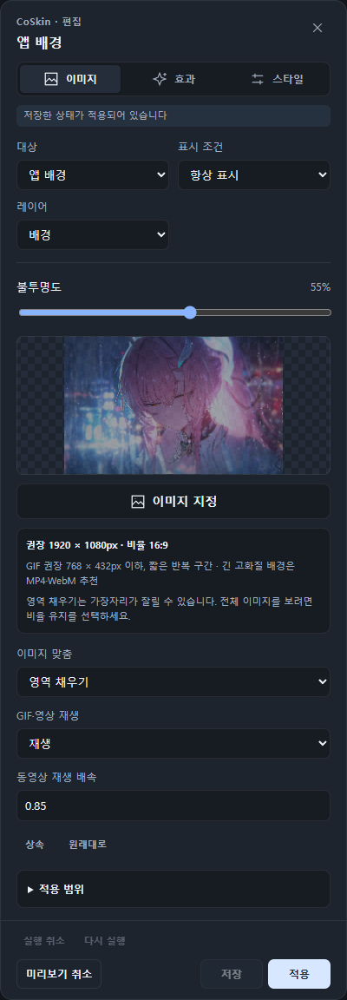

**Save** stores changes; **Apply** changes the chosen scope. Duplicates retain folders, tags and favorites. To request an AI-made theme, provide the [request template](docs/theme-request-template.md) and [file specification](docs/theme-package-spec.md).

## Animated backgrounds and background-only view

MP4 and WebM loop silently. Adjust **0.1–4× speed**, position, **Fill/Show entire image**, and opacity. Restoring a minimized window resumes playback. Videos support **512 MiB and 10 minutes per file**, with resolution, duration and decoding checks.

Use **Background only** in the title bar or **Alt+Shift+B** to hide the workspace. The embedded-browser visibility fix is included in **main after v0.1.18**. Restore with the button, the same shortcut, or **Esc**.

If a GIF or effect does not move, check theme animation options and Windows **Reduce motion**. Large GIFs can affect memory and scrolling; MP4 or WebM is preferable for long animations.

## Save backgrounds and manage downloads

**Extract background → Download original quality** saves registered media without recompression. Convert to JPG, PNG, MP4, WebM or GIF at **720p, 1080p, original resolution or a custom size**.

Add jobs and select **1–4 simultaneous jobs**. Identical media/preset jobs are deduplicated. Jobs continue after closing the extraction panel while CoSkin remains running. [Download guide](docs/background-downloads.md)

## Runtime and storage settings

Open **CoSkin settings** or switch themes from the tray.

- **Connected/playing window limits**: defaults 5/2. Allow 1–10 connections and playback within that count. Active/recent windows have priority; minimized windows stop playback.
- **Hide startup greeting**: hide the new-chat greeting while keeping the composer.
- **Shared theme storage**: view the media path and usage. Migration copies files and verifies SHA256; originals are preserved.
- **Start at Windows sign-in / Exit with Codex**: wait at sign-in or exit when the last connected Codex closes.
- **Automatic updates / Manual check**: check and install stable GitHub releases.

Media is deduplicated by SHA256. Library records, revisions and preferences stay in the original CoSkin store. Use **Refresh theme** in the tray if repainting is needed.

See the current settings screen

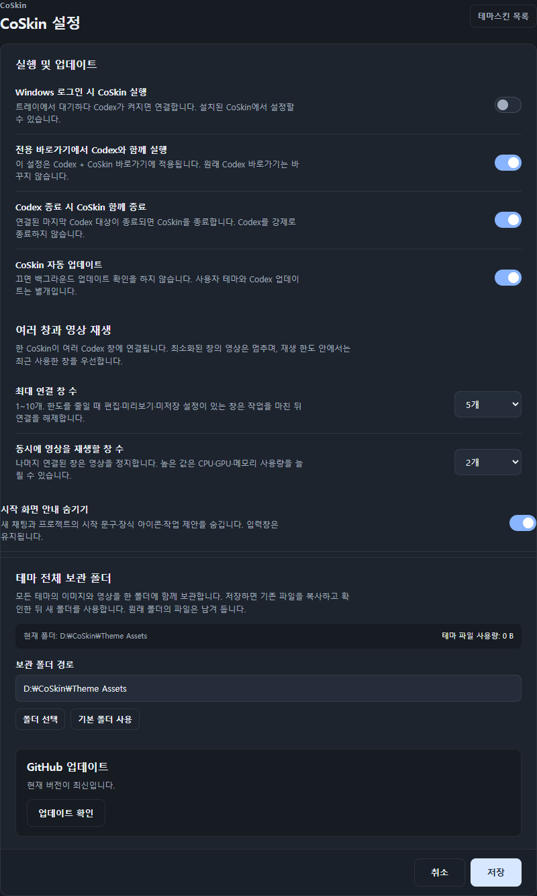

## Learn more

[Development](docs/development.md) · [Custom effects](docs/custom-effects.md) · [Support matrix](docs/support-matrix.md) · [Updates](docs/updates.md)

A source license has not yet been assigned to CoSkin. See [third-party notices](THIRD-PARTY-NOTICES.txt).
